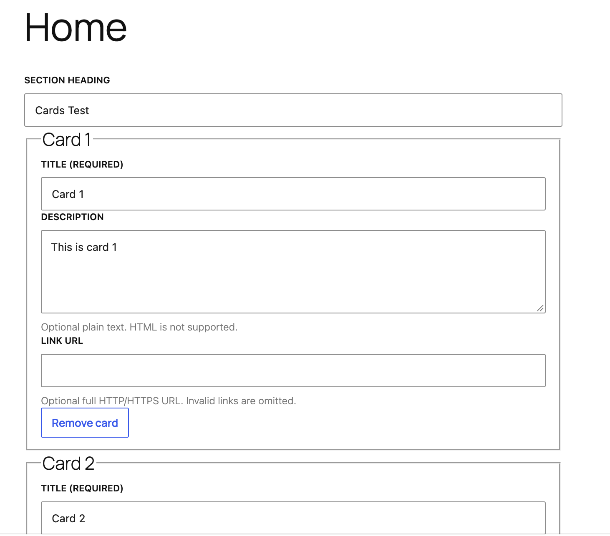
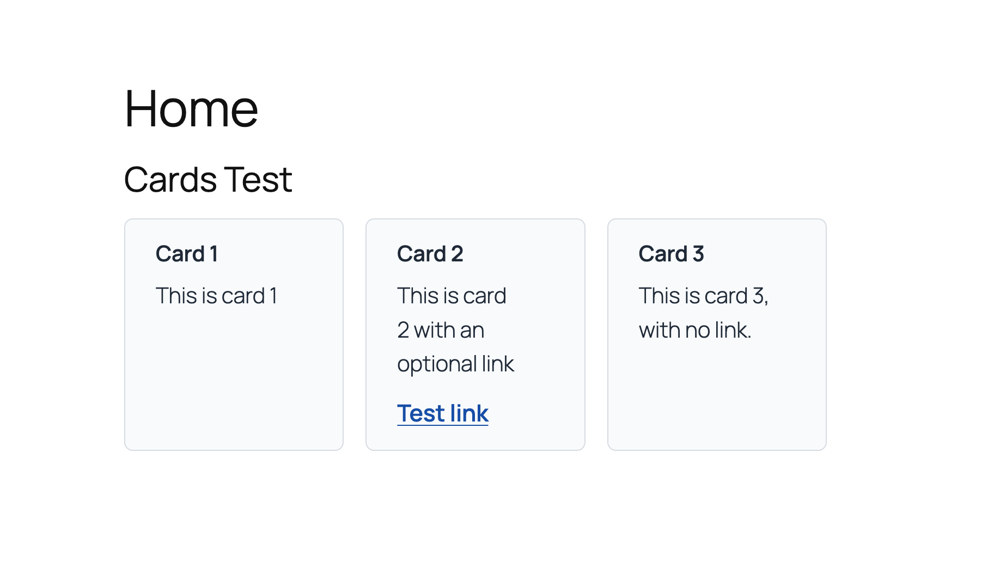

# Content Cards

A lightweight WordPress plugin that adds a Content Cards block to the Gutenberg editor.

The block displays up to three cards with a title, optional description, and optional link. It uses native WordPress APIs, PHP rendering, and responsive CSS. No ACF dependency or build process is required.

## Requirements

- WordPress 6.5+
- PHP 8.1+

## Installation

1. Copy the plugin folder to `wp-content/plugins/wp-content-cards`.
2. Activate **Content Cards** under Plugins in WordPress.
3. Open a page or post in Gutenberg and add the **Content Cards** block.

## Usage

The block is available under the Design category in Gutenberg.

You can add an optional section heading and configure between one and three cards. Each card supports a title, description, and link.

Card titles are required. Links need a valid HTTP/HTTPS URL and a label. Cards without titles and links with incomplete or invalid information are skipped during rendering.

The editor includes a live preview of the rendered cards.

Select the block and open Gutenberg's **Styles** panel to choose **Soft** (the default light surface), **Outline** (a transparent surface with a clearer border), or **Accent** (a light blue surface with a blue top border). The selected style applies to the whole group and appears in the live preview and frontend.

## Screenshots

### Editor view



### Frontend view



## How it works

The plugin registers a native Gutenberg block using `block.json`. The editor uses WordPress's built-in JavaScript components, while PHP handles the frontend output.

Block content is stored as attributes. Before rendering, PHP validates the supplied values and escapes the output.

The frontend layout uses CSS Grid and adapts to the available content width. There is no frontend JavaScript or build step.

## Testing

Run the checks from the plugin directory:

```sh
find . -name '*.php' -exec php -l {} \;
node --check blocks/content-cards/editor.js
php tests/verify.php /path/to/wordpress
```

The PHP tests cover block registration, attribute handling, card limits, links, escaping, and rendering.

**Local testing:** Plugin activation, Gutenberg editing, saving, reloading, and frontend rendering have been tested in a local WordPress environment. Desktop and mobile layouts have also been checked.

**Automated checks:** PHP lint and JavaScript syntax checks passed. All 55 isolated tests passed using WordPress 7.1.3 APIs and PHP 8.4.23, including style metadata, wrapper classes, and escaping.

Soft, Outline, and Accent were checked in the local editor's PHP preview. The default frontend was also checked at narrow, intermediate, and desktop widths with no horizontal overflow. Saving and reloading each selected style still needs manual confirmation.

Additional testing is still needed for responsive breakpoint transitions, screen readers, keyboard navigation, zoom, and longer content. Compatibility with the declared minimum WordPress and PHP versions has not been separately verified.

## Limitations

The block uses fixed heading levels and styling, so the surrounding theme and page structure should be considered.

Cards support plain text and optional links only. Images, rich text, and additional layout options are not included.

Because the block renders dynamically, deactivating the plugin removes its frontend output until the plugin is reactivated.

## License

GPL-2.0-or-later. See [LICENSE](LICENSE).
